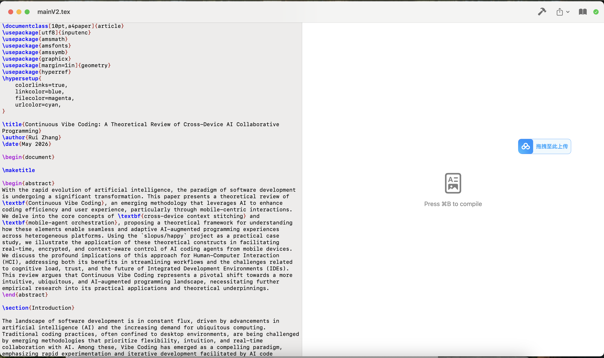
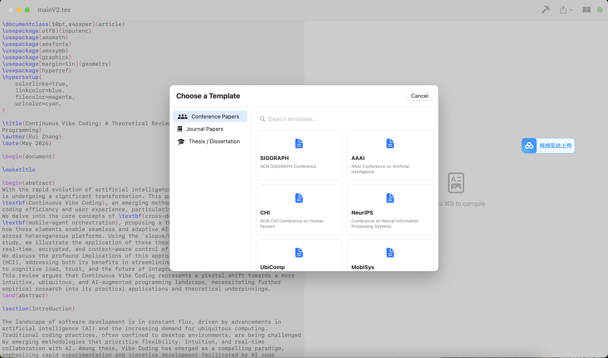
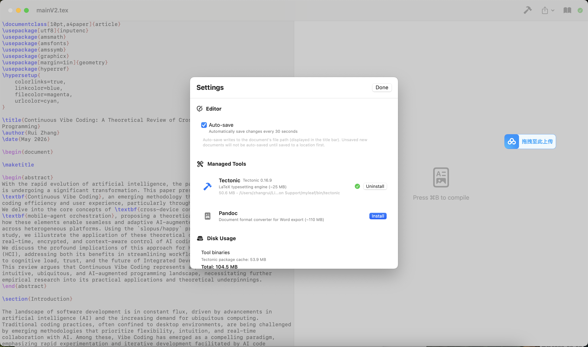

# myleaf

> 一款原生 macOS LaTeX 编辑器，专注于学术写作体验。

myleaf 是使用 SwiftUI 构建的原生 macOS LaTeX 编辑器，提供开箱即用的 LaTeX 编译、语法高亮、PDF 预览和模板管理功能。无需手动安装 TeX 发行版，应用内置 Tectonic 引擎自动安装机制。

  

---

## 截图预览

| 编辑器 |
|:------:|
|  |
| **模板选择** | **设置** |
|  |  |

---

## 功能特性

### 📝 LaTeX 编辑器
- **语法高亮**：注释、命令、环境、数学模式、括号等分类着色，支持深色/浅色模式
- **原生编辑体验**：基于 NSTextView，支持撤销/重做、自动缩进、等宽字体
- **智能粘贴**：粘贴时自动过滤富文本格式，即时语法高亮

### 📄 PDF 预览
- **实时预览**：PDFKit 驱动的 PDF 渲染，编译完成后即时显示
- **分栏布局**：可拖拽分割的编辑器 + PDF 预览分栏

### 🔧 LaTeX 编译
- **多引擎支持**：Tectonic（首选）→ pdflatex 自动降级
- **项目感知编译**：在文档所在目录编译，`\input`、图片和 `.bib` 引用均可正确解析
- **自动选择最新引擎**：逐个探测已安装的 Tectonic 版本（`--version`）并选用最新版；0.16.x 旧版可能每次启动都花数秒做 bundle index 网络检查
- **一键安装**：应用内下载安装 Tectonic（从 GitHub Release 获取）
- **可靠的进程处理**：日志写入文件（避免管道死锁），5 分钟超时自动终止
- **编译日志含阶段耗时**：记录引擎版本、命令、完整输出、退出状态，以及准备 / 引擎运行 / PDF 读取 / 总耗时，位于 `~/Library/Logs/myleaf`，可用 ⌘⇧L 在应用内查看
- **快捷键**：⌘B 一键编译

### 📦 模板系统
- **19 个内置模板**，分三类：
  - **会议论文**（8个）：AAAI、NeurIPS、CHI、SIGGRAPH、UbiComp、MobiSys、MobiCom、CCF 中文
  - **期刊论文**（3个）：SCI、EI、IEEE Transactions
  - **学位论文**（8个）：理工科/文科/艺术类本科及硕士学位论文模板（中英双语）
- 新建文档时可从模板选择器快速选取

### 📤 导出
- **PDF 导出**：将当前 PDF 预览导出到文件
- **Word 导出**：通过 Pandoc 将 LaTeX 转换为 DOCX，支持应用内一键安装 Pandoc

### 📚 BibTeX 引用管理
- 导入 `.bib` 文件，解析为结构化条目
- 搜索和批量选择引用
- 自动在 `\end{document}` 前插入 `\cite{key}`

### ⚙️ 项目管理
- **最近项目**：记录最近打开的 10 个文件
- **自动保存**：每 30 秒自动保存（可开关）
- **启动恢复**：自动打开上次编辑的项目

### 🛡️ 安全与调试
- **Release 加固**：Hardened Runtime、符号剥离、反调试保护（ptrace）
- **内存诊断**：设置页实时显示物理内存占用与峰值（每 2 秒通过 `task_info` 采样）；每分钟写入一条到 `~/Library/Logs/myleaf/memory-*.jsonl`，保留最近 7 天
- **Debug 日志**：视图 / Coordinator / ViewModel 的 Deinit 追踪

---

## 安装

### 系统要求

- macOS 14.0 (Sonoma) 或更高版本
- Apple Silicon (ARM64) 或 Intel (x86_64)

### 安装 / 卸载方式

从 [Releases](https://github.com/65zlui/myleaf/releases) 页面下载最新版本。三种方式均可在 Finder 中双击，macOS 会要求输入管理员密码。

| # | 方式 | 包 | 效果 |
|---|------|-----|------|
| 1 | **完整安装** | `myleaf-1.3.pkg`，或从 DMG/ZIP 拖拽 | 安装到 `/Applications/myleaf.app` |
| 2 | **完整卸载** | `myleaf-uninstaller-1.3.pkg`（DMG：`Uninstall myleaf.pkg`） | 删除应用**以及全部用户数据** |
| 3 | **卸载但保留数据** | `myleaf-uninstaller-keepdata-1.3.pkg`（DMG：`Uninstall myleaf (keep data).pkg`） | 只删除应用；设置、历史、工具、日志保留，供下次安装恢复 |

### 各路径与处理方式

| 内容 | 路径 | 方式 2（完整卸载） | 方式 3（保留数据） |
|------|------|-------------------|--------------------|
| 应用程序 | `/Applications/myleaf.app` | 删除 | 删除 |
| 应用管理的工具（Tectonic/Pandoc） | `~/Library/Application Support/myleaf` | 删除 | 保留 |
| 编译日志 | `~/Library/Logs/myleaf` | 删除 | 保留 |
| 偏好设置、最近项目、自动保存 | `~/Library/Preferences/com.65zlui.myleaf.plist` | 删除 | 保留 |
| Tectonic 包缓存 | `~/Library/Caches/Tectonic` | 删除 | 保留 |
| 应用缓存 / HTTP 存储 | `~/Library/Caches/com.65zlui.myleaf`、`~/Library/HTTPStorages/com.65zlui.myleaf` | 删除 | 保留 |
| 窗口状态 | `~/Library/Saved Application State/com.65zlui.myleaf.savedState` | 删除 | 保留 |
| 旧版沙盒容器 | `~/Library/Containers/com.65zlui.myleaf` | 删除 | 保留 |

无论哪种方式，你的 `.tex` 项目文件以及系统安装的 TeX / Pandoc **都不会**被删除。

> **首次启动**：应用会自动检测 LaTeX 引擎。如未安装，可在设置中一键安装 Tectonic（约 25MB）。

> **Gatekeeper 提示**：发布版本使用 ad-hoc 签名（无付费 Developer ID）。如 macOS 阻止安装包或应用，请右键选择「打开」。

> **方式 3 的作用**：保留最近项目历史、自动保存开关、已下载的工具和编译日志，重新安装后即可恢复原有使用状态。

### 手动命令

```bash
# 方式 2 —— 完整卸载
sudo rm -rf /Applications/myleaf.app
rm -rf ~/Library/Application\ Support/myleaf \
       ~/Library/Logs/myleaf \
       ~/Library/Caches/Tectonic \
       ~/Library/Caches/com.65zlui.myleaf \
       ~/Library/HTTPStorages/com.65zlui.myleaf \
       ~/Library/Preferences/com.65zlui.myleaf.plist \
       ~/Library/Saved\ Application\ State/com.65zlui.myleaf.savedState \
       ~/Library/Containers/com.65zlui.myleaf
sudo pkgutil --forget com.65zlui.myleaf

# 方式 3 —— 卸载但保留数据（只删除应用）
sudo rm -rf /Applications/myleaf.app
sudo pkgutil --forget com.65zlui.myleaf
```

### 从源码构建

```bash
git clone https://github.com/65zlui/myleaf.git
cd myleaf
open myleaf.xcodeproj
```

在 Xcode 中选择 `myleaf` scheme，按 ⌘R 运行，或选择 Product → Archive 构建发布版本。

### 打包发布

```bash
./scripts/package-app.sh
```

构建通用二进制（`arm64` + `x86_64`），使用 Hardened Runtime 进行 ad-hoc 签名，并生成：

- `dist/myleaf-1.3.pkg` —— 安装包（安装到 `/Applications`）
- `dist/myleaf-uninstaller-1.3.pkg` —— 完整卸载（应用 + 数据）
- `dist/myleaf-uninstaller-keepdata-1.3.pkg` —— 只卸载应用，保留用户数据
- `dist/myleaf-1.3.dmg` —— 拖拽安装镜像（内含两个卸载包）
- `dist/myleaf-1.3.zip`
- `dist/SHA256SUMS.txt`

---

## 使用指南

### 快捷键

| 操作 | 快捷键 |
|------|--------|
| 新建文档 | ⌘N |
| 从模板新建 | ⌘⇧N |
| 打开文件 | ⌘O |
| 保存 | ⌘S |
| 另存为 | ⌘⇧S |
| 编译 | ⌘B |
| 导出 PDF | ⌘E |
| 导出 Word | ⌘⇧E |
| 设置 | ⌘, |

### 工作流程

1. **新建文档**：使用欢迎页的「空白文档」或「从模板开始」
2. **编辑 LaTeX**：在左侧编辑器中撰写内容，语法自动高亮
3. **编译预览**：按 ⌘B 编译，右侧即时显示 PDF
4. **导出分享**：通过工具栏的 Export 菜单导出 PDF 或 Word
5. **管理引用**：点击 BibTeX 按钮导入 `.bib` 文件并插入引用

---

## 技术栈

| 层级 | 技术 |
|------|------|
| UI 框架 | SwiftUI + AppKit (NSViewRepresentable) |
| 架构 | MVVM + Service Layer |
| 状态管理 | `@Observable` (iOS 17+) |
| PDF 渲染 | PDFKit |
| 编辑器 | NSTextView + 正则语法高亮 |
| LaTeX 引擎 | Tectonic / pdfLaTeX |
| Word 导出 | Pandoc (LaTeX → DOCX) |
| 进程管理 | `Process` + 日志文件重定向与超时 |
| 持久化 | UserDefaults (项目历史) |
| 诊断 | `task_info(TASK_VM_INFO)` 采样 + JSONL 内存日志 |

### 外部依赖

**编译时**：无（仅使用 Apple 原生框架：Foundation、SwiftUI、PDFKit、AppKit）

**运行时**：
- Tectonic（可选，应用内自动安装）
- pdfLaTeX（可选，需系统安装 MacTeX）
- Pandoc（可选，应用内自动安装）

---

## 目录结构

```
myleaf/
├── myleaf/                     # 主应用
│   ├── Models/                 # 数据模型
│   ├── ViewModels/             # 状态管理 (EditorViewModel)
│   ├── Views/                  # SwiftUI 视图
│   ├── Services/               # 业务服务层
│   ├── Utils/                  # 工具类
│   └── Resources/Templates/    # 19 个 LaTeX 模板
├── myleafTests/                # 单元测试 + 编译集成测试
├── myleafUITests/              # UI 测试
├── scripts/                    # 发布打包脚本
└── myleaf.xcodeproj            # Xcode 项目
```

---

## 测试

```bash
xcodebuild -scheme myleafTests -configuration Debug test
```

测试覆盖：
- 模板加载与分类
- BibTeX 解析
- 项目历史管理
- 文档模型验证
- LaTeX 编译端到端流程（未安装 TeX 引擎时自动跳过）
- ViewModel 编译状态与 PDF 预览联动
- 编译日志持久化

完整的「问题定位 → 代码修改 → 验证」过程见 [DEBUGGING.md](DEBUGGING.md)。

---

## 许可证

[MIT License](LICENSE)

---

## 作者

**张锐** — [65zlui](https://github.com/65zlui)

---

*让 LaTeX 写作更简单。*
