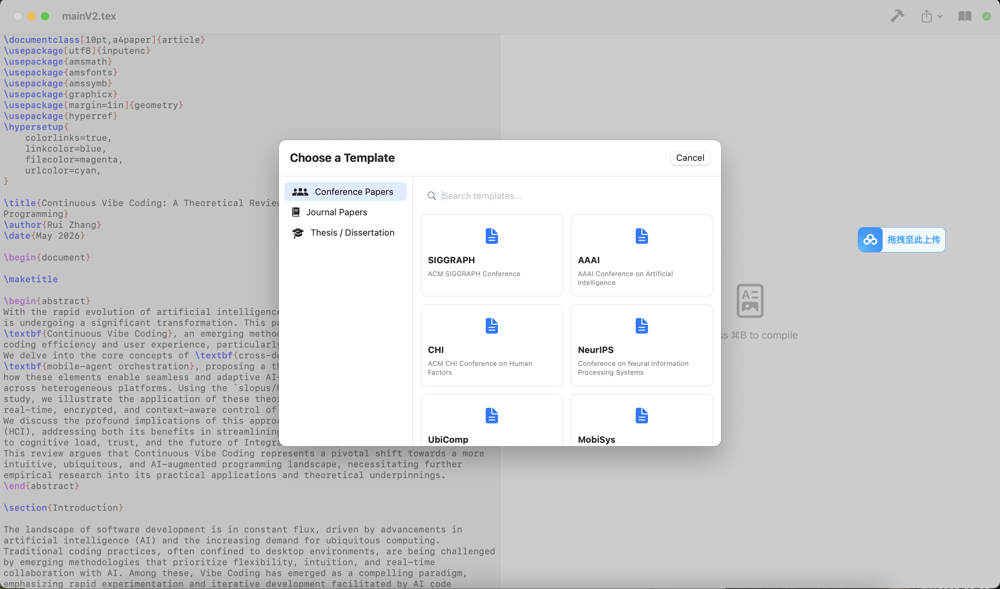
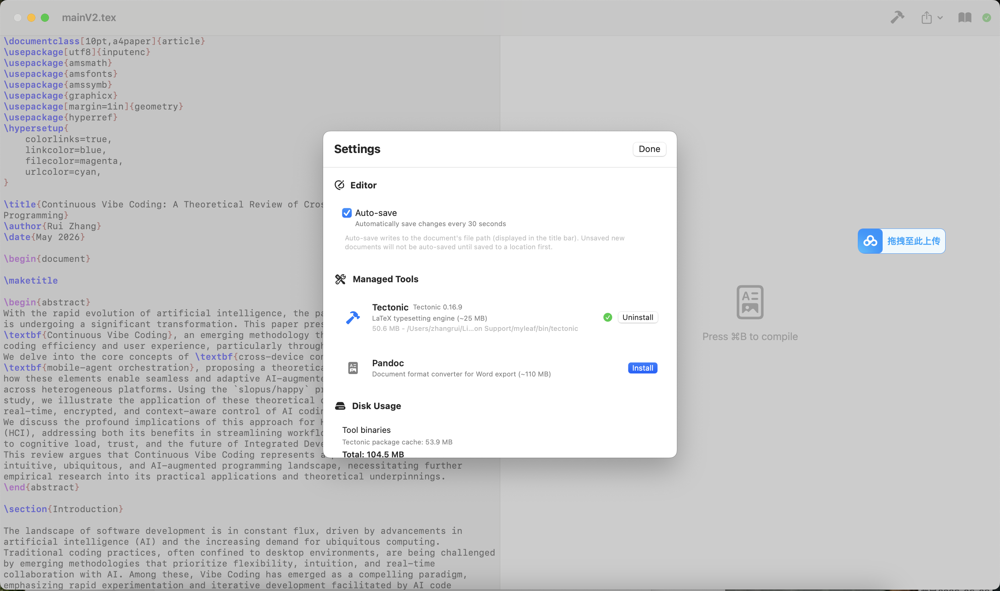

# myleaf

> A native macOS LaTeX editor crafted for academic writing.

myleaf is a native macOS LaTeX editor built with SwiftUI, offering out-of-the-box LaTeX compilation, syntax highlighting, PDF preview, and template management. No manual TeX distribution installation required — the app features automatic Tectonic engine installation.

  

---

## Screenshots

| **Template Picker** | **Settings** |
|  |  |

---

## Features

### LaTeX Editor
- **Syntax highlighting**: Color-coded tokens for comments, commands, environments, math mode, and braces with dark/light mode support
- **Native editing experience**: NSTextView-based with undo/redo, auto-indent, monospaced font; undo history is capped at 100 levels to bound memory on large documents
- **Smart paste**: Automatically strips rich text formatting on paste, with instant syntax highlighting

### PDF Preview
- **Live preview**: PDFKit-powered rendering, displayed immediately after compilation
- **Split-pane layout**: Draggable divider between editor and PDF preview
- **File-backed PDFs**: Compiled PDFs are cached in `~/Library/Caches/myleaf/pdfs` (max 3 files) and opened by URL, avoiding a full in-memory `Data` copy for large documents

### LaTeX Compilation
- **Multi-engine support**: Tectonic (preferred) with automatic fallback to pdflatex
- **Project-aware**: Compiles in the document's folder, so `\input`, `\includegraphics`, and `.bib` references resolve correctly
- **Newest-engine selection**: Probes every installed Tectonic build (`--version`) and uses the newest one; older 0.16.x releases can spend seconds on bundle-index network checks before doing any work
- **One-click install**: In-app Tectonic download and installation from GitHub Releases
- **Reliable process handling**: Logs are captured to files (no pipe deadlocks) and a 5-minute timeout stops runaway builds
- **Build logs with phase timings**: Every compile records engine version, command, full output, exit status, and preparation / engine-run / PDF-read / total wall time under `~/Library/Logs/myleaf`, viewable in-app with Cmd+Shift+L
- **Shortcut**: Cmd+B to compile

### Template System
- **19 built-in templates** in three categories:
  - **Conference** (8): AAAI, NeurIPS, CHI, SIGGRAPH, UbiComp, MobiSys, MobiCom, CCF Chinese
  - **Journal** (3): SCI, EI, IEEE Transactions
  - **Thesis** (8): Bilingual Chinese/English templates for Science, Engineering, Liberal Arts, and Fine Arts — both Bachelor's and Master's levels
- Quick template selection when creating new documents

### Export
- **PDF export**: Save the current PDF preview to a file
- **Word export**: Convert LaTeX to DOCX via Pandoc, with in-app Pandoc installation

### BibTeX Reference Management
- Import `.bib` files with structured entry parsing
- Search and batch-select citations
- Automatic `\cite{key}` insertion before `\end{document}`

### Project Management
- **Recent projects**: Remembers the last 10 opened files
- **Auto-save**: Automatic save every 30 seconds (toggleable)
- **Session restore**: Reopens the last edited project on launch

### Security & Diagnostics
- **Release hardening**: Hardened Runtime, symbol stripping, anti-debug protection (ptrace)
- **Performance panel**: Settings → Performance shows a live physical-footprint chart (1/5/15/30 min), current/peak/resident counters, and per-compile phase timings (preparation / engine / PDF cache) with the recent build list
- **Memory diagnostics**: Live physical footprint and peak (sampled every 2 s via `task_info`); one sample per minute is written to `~/Library/Logs/myleaf/memory-*.jsonl` (last 7 days kept)
- **Debug logging**: deinit tracing for views, coordinators, and the view model

---

## Installation

### System Requirements

- macOS 14.0 (Sonoma) or later
- Apple Silicon (ARM64) or Intel (x86_64)

### Install / uninstall modes

Download the latest release from the [Releases](https://github.com/65zlui/myleaf/releases) page. There are three supported modes; all packages can be double-clicked in Finder and macOS will ask for an administrator password.

| # | Mode | Package | Effect |
|---|------|---------|--------|
| 1 | **Full install** | `myleaf-0.1.pkg`, or drag the app from the DMG/ZIP | Installs `/Applications/myleaf.app` |
| 2 | **Full uninstall** | `myleaf-uninstaller-0.1.pkg` (DMG: `Uninstall myleaf.pkg`) | Removes the app **and** all per-user data |
| 3 | **Uninstall, keep data** | `myleaf-uninstaller-keepdata-0.1.pkg` (DMG: `Uninstall myleaf (keep data).pkg`) | Removes only the app; settings, history, tools, and logs stay for the next install |

### Paths

| What | Path | Mode 2 (full) | Mode 3 (keep data) |
|------|------|---------------|--------------------|
| Application | `/Applications/myleaf.app` | removed | removed |
| Managed tools (Tectonic/Pandoc) | `~/Library/Application Support/myleaf` | removed | kept |
| Build logs | `~/Library/Logs/myleaf` | removed | kept |
| Preferences, recent projects, auto-save | `~/Library/Preferences/com.65zlui.myleaf.plist` | removed | kept |
| Tectonic package cache | `~/Library/Caches/Tectonic` | removed | kept |
| App cache / HTTP storage | `~/Library/Caches/com.65zlui.myleaf`, `~/Library/HTTPStorages/com.65zlui.myleaf` | removed | kept |
| PDF preview cache | `~/Library/Caches/myleaf/pdfs` | removed | kept |
| Saved window state | `~/Library/Saved Application State/com.65zlui.myleaf.savedState` | removed | kept |
| Legacy sandbox container | `~/Library/Containers/com.65zlui.myleaf` | removed | kept |

Your `.tex` projects and system TeX/Pandoc installations are **never** touched in any mode.

> **First launch**: The app will automatically detect available LaTeX engines. If none are found, you can install Tectonic with one click in Settings (~25MB download).

> **Gatekeeper note**: Release builds are ad-hoc signed (no paid Developer ID). If macOS blocks the installer or app, right-click it and choose **Open**.

> **Mode 3** keeps recent-project history, the auto-save setting, downloaded tools, and build logs, so reinstalling restores your setup.

### Manual commands

```bash
# Mode 2 — full uninstall
sudo rm -rf /Applications/myleaf.app
rm -rf ~/Library/Application\ Support/myleaf \
       ~/Library/Logs/myleaf \
       ~/Library/Caches/Tectonic \
       ~/Library/Caches/com.65zlui.myleaf \
       ~/Library/Caches/myleaf \
       ~/Library/HTTPStorages/com.65zlui.myleaf \
       ~/Library/Preferences/com.65zlui.myleaf.plist \
       ~/Library/Saved\ Application\ State/com.65zlui.myleaf.savedState \
       ~/Library/Containers/com.65zlui.myleaf
sudo pkgutil --forget com.65zlui.myleaf

# Mode 3 — keep data (only the app is removed)
sudo rm -rf /Applications/myleaf.app
sudo pkgutil --forget com.65zlui.myleaf
```

### Build from Source

```bash
git clone https://github.com/65zlui/myleaf.git
cd myleaf
open myleaf.xcodeproj
```

Select the `myleaf` scheme in Xcode, press Cmd+R to run, or choose Product > Archive for a release build.

### Package a Release

```bash
./scripts/package-app.sh
```

Builds a universal (`arm64` + `x86_64`) binary, ad-hoc signs it with the hardened runtime, and writes:

- `dist/myleaf-0.1.pkg` — installer (installs to `/Applications`)
- `dist/myleaf-uninstaller-0.1.pkg` — full uninstall (app + data)
- `dist/myleaf-uninstaller-keepdata-0.1.pkg` — uninstall the app, keep user data
- `dist/myleaf-0.1.dmg` — drag-to-Applications image (includes both uninstallers)
- `dist/myleaf-0.1.zip`
- `dist/SHA256SUMS.txt`

---

## Usage Guide

### Keyboard Shortcuts

| Action | Shortcut |
|--------|----------|
| New Document | Cmd+N |
| New from Template | Cmd+Shift+N |
| Open File | Cmd+O |
| Save | Cmd+S |
| Save As | Cmd+Shift+S |
| Compile | Cmd+B |
| Export PDF | Cmd+E |
| Export Word | Cmd+Shift+E |
| Settings | Cmd+, |

### Workflow

1. **Create a document**: Use the welcome screen to start blank or pick a template
2. **Edit LaTeX**: Write your content in the editor with automatic syntax highlighting
3. **Compile & preview**: Press Cmd+B to compile — the PDF renders instantly on the right
4. **Export**: Use the Export menu in the toolbar for PDF or Word output
5. **Manage references**: Click the BibTeX button to import `.bib` files and insert citations

---

## Technology Stack

| Layer | Technology |
|-------|-----------|
| UI Framework | SwiftUI + AppKit (NSViewRepresentable) |
| Architecture | MVVM + Service Layer |
| State Management | `@Observable` (iOS 17+) |
| PDF Rendering | PDFKit |
| Text Editor | NSTextView with regex syntax highlighting |
| LaTeX Engine | Tectonic / pdfLaTeX |
| Word Export | Pandoc (LaTeX to DOCX) |
| Process Management | `Process` with log-file redirection and timeouts |
| Persistence | UserDefaults (project history) |
| Diagnostics | `task_info(TASK_VM_INFO)` sampling + JSONL memory logs |

### Dependencies

**Compile-time**: None (uses only Apple frameworks: Foundation, SwiftUI, PDFKit, AppKit)

**Runtime**:
- Tectonic (optional, auto-installable)
- pdfLaTeX (optional, requires system MacTeX installation)
- Pandoc (optional, auto-installable)

---

## Project Structure

```
myleaf/
├── myleaf/                     # Main application
│   ├── Models/                 # Data models
│   ├── ViewModels/             # State management (EditorViewModel)
│   ├── Views/                  # SwiftUI views
│   ├── Services/               # Business logic services
│   ├── Utils/                  # Utility classes
│   └── Resources/Templates/    # 19 LaTeX templates
├── myleafTests/                # Unit + compilation integration tests
├── myleafUITests/              # UI tests
├── scripts/                    # Release packaging script
└── myleaf.xcodeproj            # Xcode project
```

---

## Testing

```bash
xcodebuild -scheme myleafTests -configuration Debug test
```

The suite covers:
- Template loading and categorization
- BibTeX file parsing
- Project history management
- Document model validation
- LaTeX compilation end-to-end (skipped automatically when no TeX engine is installed)
- View-model compile state and PDF preview wiring
- Build-log persistence

See [DEBUGGING.md](DEBUGGING.md) for the full record of how each bug was located, fixed, and verified.

---

## License

[MIT License](LICENSE)

---

## Author

**Zhang Rui** — [65zlui](https://github.com/65zlui)

---

*Making LaTeX writing simpler.*
